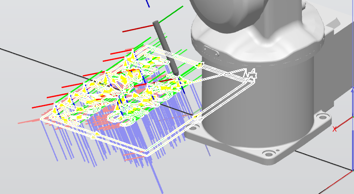
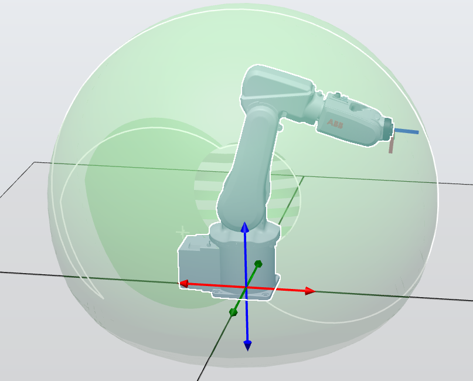
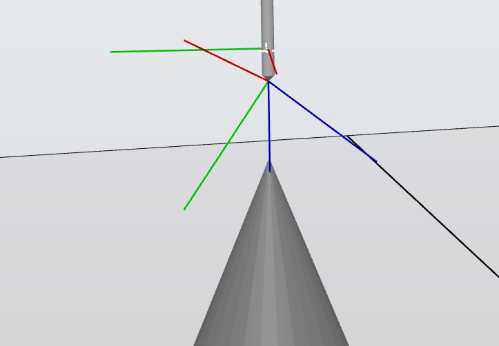
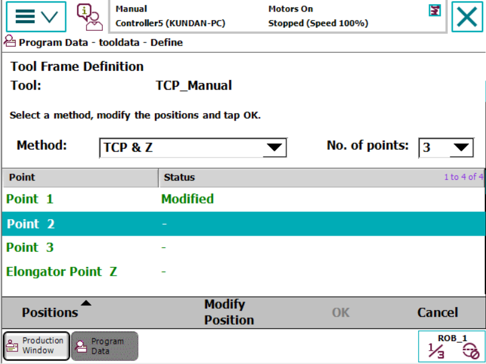
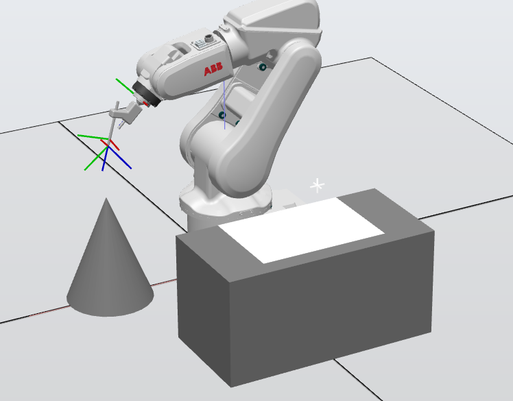

# ABB IRB120 Robotic Arm Simulation

Offline programming of an ABB IRB120 industrial robot in RobotStudio to write a name on paper with a pen tool. The work covers building the tool, calibrating its tool centre point (TCP), setting up the workstation, generating the writing path, and transferring the program to the real robot.

**Demonstration video:** [Watch on Google Drive](https://drive.google.com/file/d/1JGJSQJtmIBj57lg4zQ2QsrylhnvFJI0F/view?usp=drive_link)

  

## My contribution

- Simulated robot motion in ABB RobotStudio
- Configured the tool tip and TCP for the writing application
- Programmed the robot trajectory for writing my name
- Tested and validated motion accuracy in simulation

## What was done

### 1. Robot and controller setup

Added an IRB120 from the ABB library with a virtual controller (RobotWare 6.01), then practised joint and linear jogging, both directly and through the virtual FlexPendant. Checked the robot's work envelope and compared it with the larger IRB1600.

  

### 2. Building the pen tool

Imported the pen holder CAD, separated it into bodies, and built it as a RobotStudio tool mechanism with three links and two joints. Created a tool frame at the pen tip from three points, with the Z axis pointing out of the pen, then mounted the tool on the robot flange.

### 3. TCP calibration

A tool frame defined in simulation rarely matches the real tool once it is mounted, so the TCP was also taught the way it is done on a real robot. Using the FlexPendant's **TCP & Z** method, the pen tip was jogged to touch the tip of a reference cone from three different orientations, with a fourth elongator point to define the Z direction.

  
  

### 4. Workstation

Modelled the lab setup: a table 0.25 m from the robot in X and an A4 sheet on its edge facing the robot, so targets in simulation match positions in the lab.

  

### 5. Path programming

Created targets for each stroke of the name, added them to a path, and used auto-configuration to check that the robot can reach every target without a configuration error. Key settings:

- Pen held at an angle, as when writing by hand
- Speed `v100`, so the robot writes at a natural pace
- Zone `fine`, so the path passes exactly through each target

The path was verified with **Move Along Path** and then synchronised to RAPID.

### 6. Transfer to the real robot

Connected RobotStudio to the robot controller, took a backup, requested write access, and transferred the RAPID program to the physical IRB120.

## Results

- Simulated the complete writing motion in RobotStudio
- Calibrated the TCP for a precision tool task
- Validated the trajectory before running it on the physical robot

## Future improvements

- More complex drawing tasks
- Smoother paths
- Different tool configurations
- Additional industrial handling tasks

## Repository contents

- `Minor Project_Kundan_Singh_48849855.rspag` — RobotStudio Pack & Go file with the station, tool and program
- `Log book.pdf` — step-by-step log of the setup, tool building, TCP calibration and path programming
- `images/` — figures used in this README

To open the project, use **File → Share → Unpack and Work** in ABB RobotStudio.

## Technologies

ABB RobotStudio • ABB IRB120 • RAPID • IRC5 FlexPendant • TCP calibration • Offline path programming
