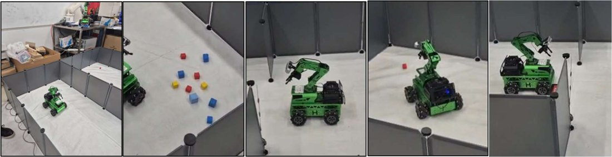
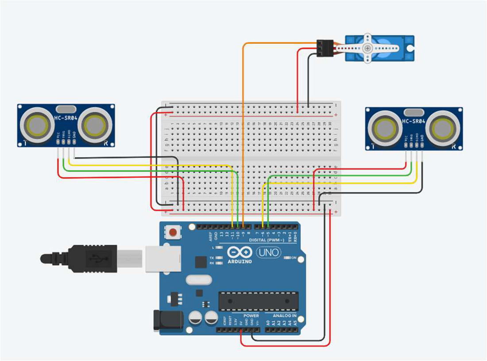
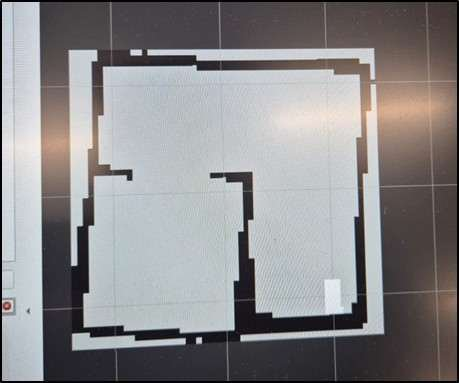
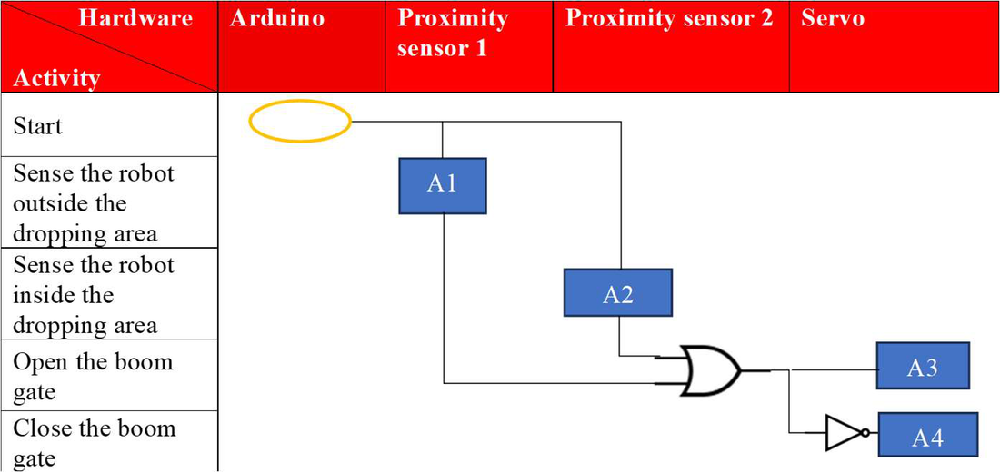

# Autonomous Rover using ROS 2 & SLAM

An autonomous package-transport system: a ROS 2 rover maps a sandbox with LiDAR, navigates between recorded waypoints, picks up a block with its 6-DOF arm, waits at an automatic boom gate, and delivers the block to a drop zone before returning home.

Built as the major project for MTRN6060 (Robotics and Automation) at Macquarie University by a team of three.

**Demonstration videos:** [Video 1](https://drive.google.com/file/d/13v-a29XmUb4YCfFoLEbIvHaU_6uxZ1su/view?usp=drive_link) · [Video 2](https://drive.google.com/file/d/1iHogu2stk_f4VkaUr_RzlIDm672PT2Lk/view?usp=drive_link)

<p align="center">
  
</p>

## My contribution

- Wrote the Python mission-control logic that decides what the rover does and when during the task sequence
- Implemented the boom gate detection and control logic
- Tested the integration between rover behaviour and gate operation
- Prepared project documentation and report content

## System overview

The system has two independent subsystems that never exchange messages. The rover detects the gate with its LiDAR, and the gate detects the rover with ultrasonic sensors.

### Rover

| Component | Details |
|---|---|
| Platform | Hiwonder JetRover M1, mecanum-wheel chassis |
| Main controller | NVIDIA Jetson Orin Nano (8 GB), Ubuntu, ROS 2 Humble |
| Motion controller | STM32 with onboard gyroscope and accelerometer |
| Sensors | LiDAR, 3D depth camera, wheel encoders, IMU |
| Manipulator | 6-DOF arm with serial bus servos |
| Operator link | Wi-Fi from a laptop running MobaXterm |

### Boom gate

| Component | Details |
|---|---|
| Controller | Arduino Uno |
| Sensors | Two ultrasonic sensors, mounted diagonally at the entry and exit sides |
| Actuator | Servo motor driving the gate arm |

<p align="center">
  
</p>

## How it works

### Mapping and waypoints

The sandbox was mapped by driving the rover manually while the SLAM node built a 2D map from LiDAR scans, checked in RViz. The rover was then driven to each key location and its pose saved as `(x, y, yaw)`: home, pickup, a mid waypoint, before the gate, drop-off, and the return side of the gate.

<p align="center">
  
</p>

### Mission control (`mission_control_GROUP1.py`)

A single ROS 2 node, `smart_commander_node`, runs the mission in a loop:

1. Navigate to the pickup waypoint with Nav2 and call the `/automatic_pick/pick` service.
2. Drive through the mid waypoint to the point before the gate.
3. Wait until the gate is open. The node reads the front LiDAR beam from `/scan` and treats the gate as open when the distance is above 0.2 m.
4. Drive through to the drop zone and call `/automatic_pick/place`.
5. Move to the return side of the gate, wait for it to open again, and go home.

Yaw is stored in degrees and converted to a quaternion before each goal is sent to Nav2. A failed cycle is logged and the loop retries.

### Boom gate (`Boom_Gate_Servo_US.ino`)

The Arduino reads both ultrasonic sensors continuously. If either one sees an object closer than 40 cm, it opens the gate and holds it for 5 seconds so the gate cannot close on the rover in a sensor blind spot. Otherwise the gate stays closed.

The sensors were first mounted parallel to the gate, but that detected the rover too late. Mounting them diagonally lets them see the rover approaching at an angle, at least 6 inches before it reaches the gate.

<p align="center">
  
</p>

## Running it

On the rover:

```bash
sudo systemctl stop start_app_node.service
ros2 launch example navigation_transport.launch.py map:=Sandbox_week10
python3 mission_control_GROUP1.py
```

The waypoint coordinates in the script belong to our sandbox map, so they need re-recording for any other environment. The script depends on the navigation and automatic pick/place services from the Hiwonder JetRover software stack.

For the gate, flash `Boom_Gate_Servo_US.ino` to an Arduino Uno with the servo on pin 9, the entry sensor on pins 10 (trigger) and 11 (echo), and the exit sensor on pins 5 (trigger) and 6 (echo).

## Results

- Built a complete 2D SLAM map of the sandbox and recorded all mission waypoints.
- Ran the full automatic loop successfully in testing: pickup, wait at the gate, drop, return through the gate, home.
- The boom gate detected the rover and opened and closed as designed.

## Limitations and lessons

- During the final demonstration the rover failed to pick up the block, although the arm had been calibrated for it. Wheel slip on a dusty floor is a likely cause, since it creates a mismatch between the rover's estimated and actual position.
- The rover turned towards a wall when leaving the drop zone, because the planner was looking for the shortest path. More intermediate waypoints would constrain the route.
- Colour-based picking was unreliable when blocks were close together or several shared a colour.
- A planned strategy of three pickup waypoints for scattered blocks, and the traffic-light task, were not implemented in time.
- The platform was slow to start and often dropped its Wi-Fi connection, which cost a large share of each lab session.

## Repository contents

- `mission_control_GROUP1.py` — ROS 2 mission-control node
- `Boom_Gate_Servo_US.ino` — Arduino boom gate firmware
- `MTRN6060_Group_1_Friday_1200.pdf` — full project report
- `images/` — figures used in this README

## Technologies

ROS 2 Humble • Nav2 • Python • SLAM • RViz • NVIDIA Jetson Orin Nano • LiDAR • 3D depth camera • Arduino
