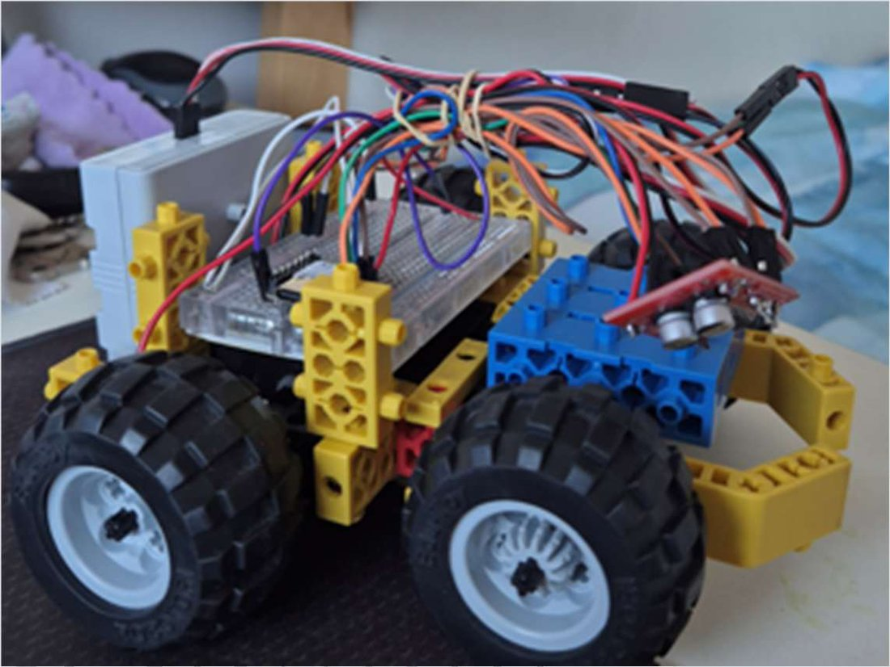
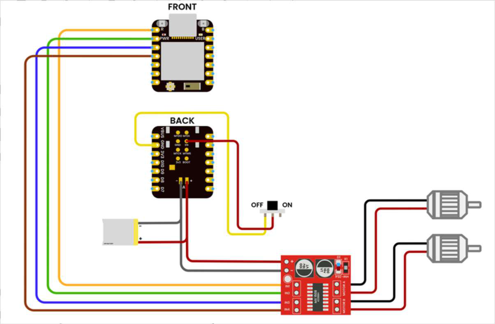
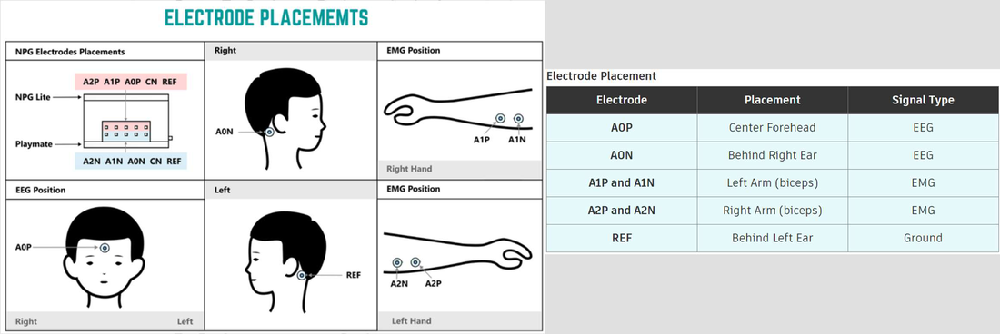

# EEG & EMG Signal-Driven Rover

A two-wheeled rover driven by the body's own electrical signals: brain activity (EEG) moves it forward, and muscle activity in each arm (EMG) steers it. A wearable sensing board reads the signals and sends commands to the rover over Bluetooth Low Energy.

Prepared as a hands-on build and lesson plan for Robothink (November 2025).

**Demonstration videos:** [Video 1](https://drive.google.com/file/d/11HOqrbe95BxjA0kZQDmbAcDNC5bvYzF-/view?usp=drive_link) · [Video 2](https://drive.google.com/file/d/1jfVsmZnXtSiHwSRBjM_QpO7BP4vkhlEd/view?usp=drive_link)

  

## My contribution

- Designed and assembled the rover hardware
- Integrated the NPG Lite sensing board and the XIAO ESP32C6 into one system
- Wired the MX1508 motor driver and DC motors
- Uploaded existing firmware to both boards
- Tested the rover's response to EEG and EMG signals
- Wrote the lesson plan in `EEG EMG Rover.pdf`

The firmware in this folder is existing code for the NPG Lite platform, not written by me.

## How it works

The system has a talker and a listener.

**Talker: NPG Lite (worn by the user).** An ESP32-based biopotential board from Upside Down Labs reads three channels: one EEG and one EMG from each arm.

**Listener: XIAO ESP32C6 (on the rover).** It connects to the talker over BLE, receives a command number, and switches the motor driver pins.

| Signal | Command | Rover action |
|---|---|---|
| EEG beta-band power above threshold (focus) | 3 | Drive forward |
| EMG from one arm | 1 or 2 | Turn, by driving one wheel |
| EMG from both arms together | 4 | Reverse |
| None of the above | 0 | Stop |

### Signal processing on the talker (`BLE-BCI-Car-Remote.ino`)

- Samples all three channels at 512 Hz.
- Removes 50 Hz mains noise from every channel with a notch filter.
- **EEG:** low-pass filters the signal, runs a 512-point FFT, and computes power in the delta, theta, alpha, beta and gamma bands. When beta power exceeds 5% of total power, it sends "forward".
- **EMG:** high-pass filters each arm's signal at 70 Hz and tracks its envelope with a moving average. An envelope above the threshold counts as a flex.

Both thresholds are constants in the sketch and need tuning for each person.

### Motor control on the listener (`BLE-BCI-Car.ino`)

The XIAO scans for the talker's BLE service, subscribes to notifications, and sets four output pins (`D0`–`D3`) that feed the MX1508's inputs for the left and right motors.

  

## Hardware

| Part | Purpose |
|---|---|
| NPG Lite | Reads EEG and EMG signals and sends commands |
| Snap cables and gel electrodes | Connect the board to the skin |
| Nuprep gel and alcohol wipes | Clean the skin and improve electrode contact |
| XIAO ESP32C6 | Receives commands on the rover |
| MX1508 dual H-bridge driver | Drives both motors, up to 1.5 A each |
| 2 × geared DC motors (6–12 V) | Differential drive |
| Robothink chassis blocks, wheels, battery | Rover body and power |

  

## Building it

1. Assemble the chassis with the two motors and wheels.
2. Connect the motors to the MX1508: motor A to the left wheel, motor B to the right.
3. Wire the MX1508 inputs to pins `D0`–`D3` on the XIAO ESP32C6 and connect the battery.
4. In the Arduino IDE, install the **esp32** board package by Espressif, version 3.2.0, and the Adafruit NeoPixel library.
5. Select **ESP32C6 Dev Module** and enable **USB CDC On Boot**.
6. Upload `BLE-BCI-Car-Remote.ino` to the NPG Lite and `BLE-BCI-Car.ino` to the XIAO.
7. Clean the skin, attach the electrodes and snap cables, and power both boards. They pair automatically.

The lesson plan PDF walks through each step with photos.

## Results

- Assembled and tested the rover platform.
- Verified the wireless link between the sensing board and the rover.
- Demonstrated rover movement controlled by EEG and EMG signals.

## Future improvements

- Better signal filtering and classification
- Custom firmware for finer control
- More robust wireless communication
- Improved stability and motion precision

## Repository contents

- `BLE-BCI-Car-Remote.ino` — talker firmware for the NPG Lite
- `BLE-BCI-Car.ino` — listener firmware for the rover
- `EEG EMG Rover.pdf` — lesson plan with build steps
- `images/` — figures used in this README

## Technologies

ESP32 (NPG Lite, XIAO ESP32C6) • Bluetooth Low Energy • Arduino IDE • ESP-DSP (FFT) • MX1508 motor driver • EEG/EMG electrodes
