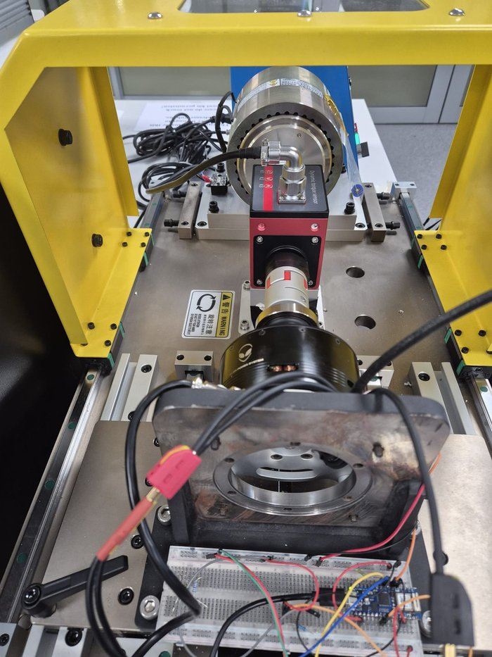
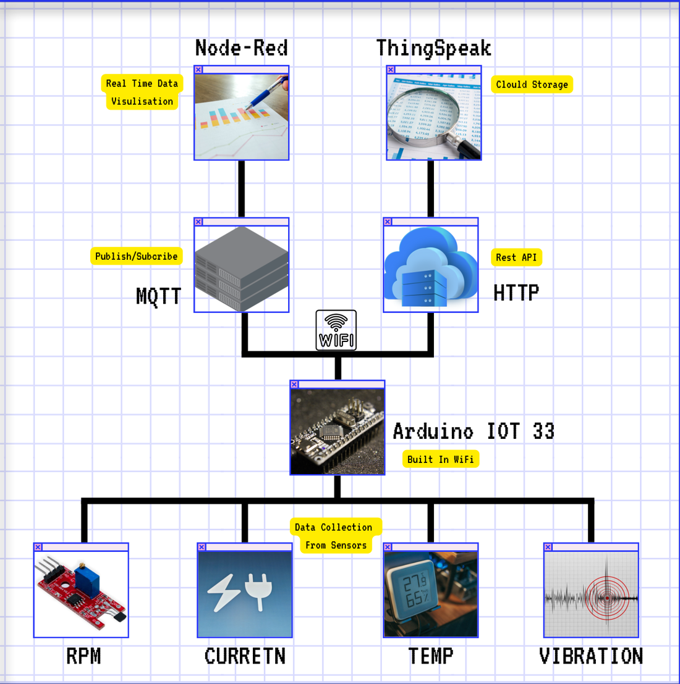
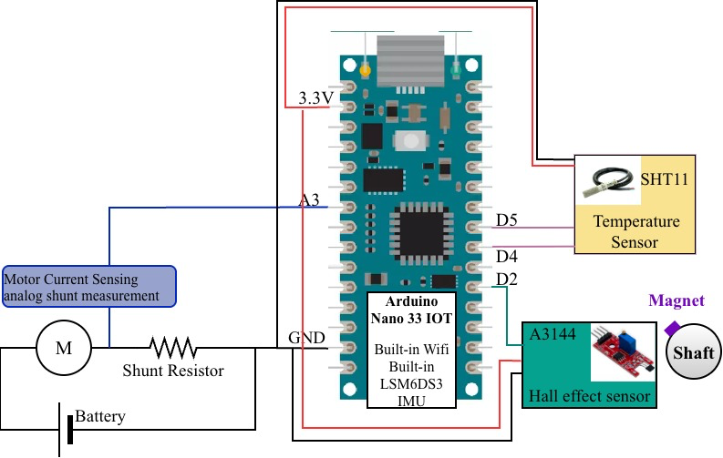
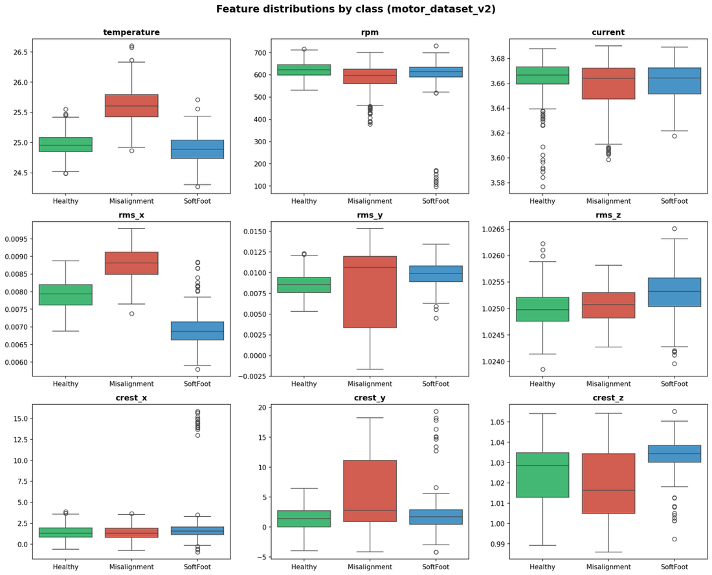
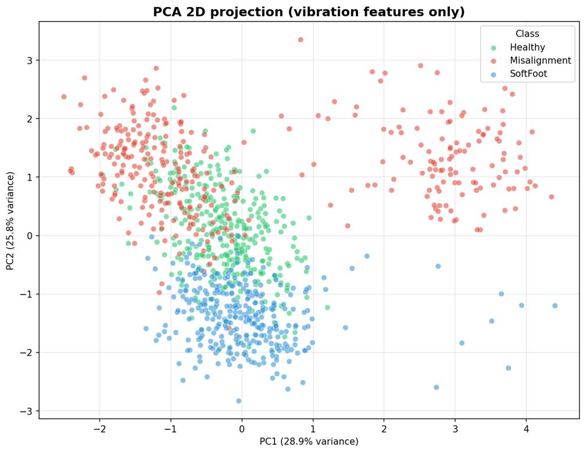
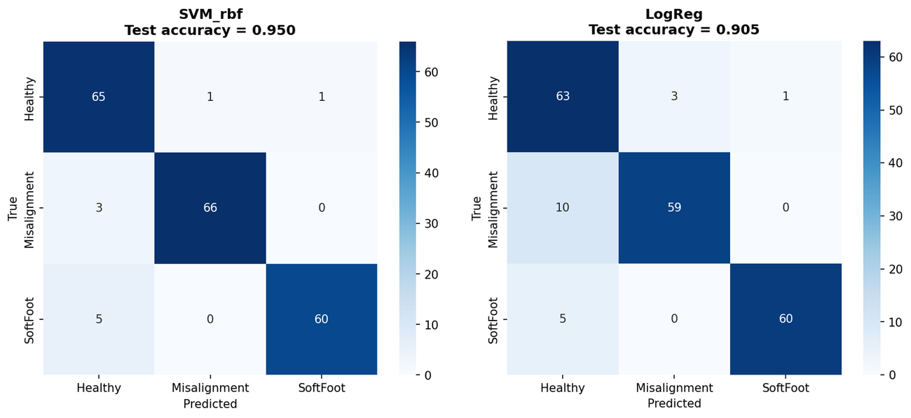
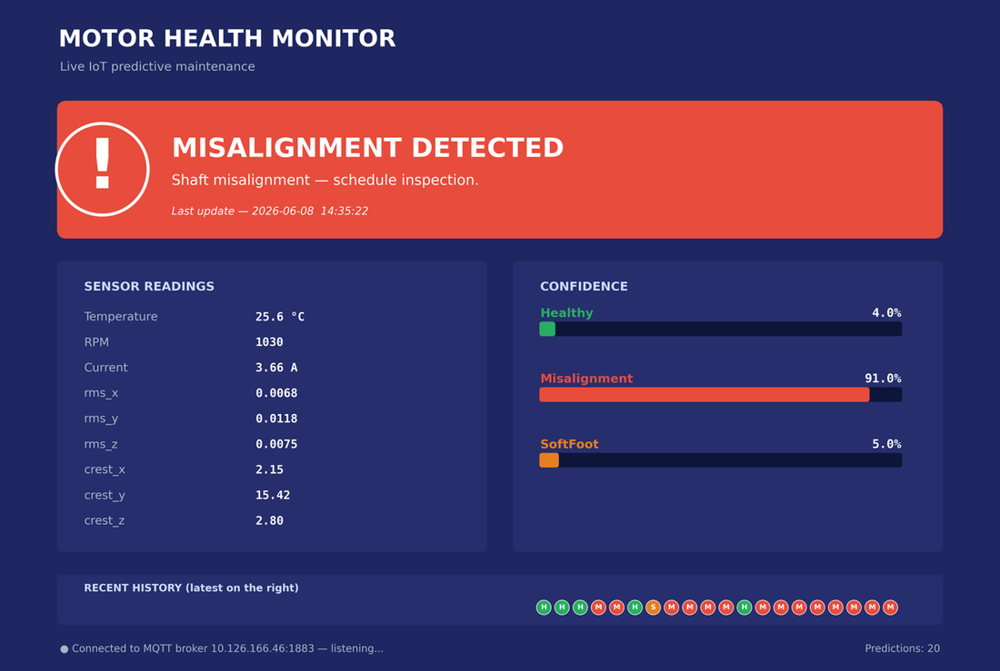

# IIoT Condition Monitoring of an Electric Motor

A low-cost Industrial IoT sensor node that monitors a DC motor's vibration, current, temperature and speed, extracts vibration features on the device, and classifies the motor as **healthy**, **soft-foot / loose screw** or **shaft misalignment** in real time.

On the held-out test set, an SVM with an RBF kernel reached **95.0% accuracy**, against 90.6% for logistic regression.

> **Paper:** *A Low-Cost IIoT Multi-Sensor Platform for Real-Time Electric Motor Fault Detection* — M. Hojati, S. Yaabdollahi, K. S. Shekhawat, M. S. Saeed and S. C. Mukhopadhyay, School of Engineering, Macquarie University. Accepted at ICST 2026. [Read the paper](Paper-ICST2026-motor-monitoring.pdf).

The platform was first built for ENGG8201 (Internet of Things Systems Design) at Macquarie University; the [course presentation](Group_8_IOT_ENGG8201_Project_Submission.pdf) is also in this folder.

<p align="center">
  
</p>

## How it works

1. **Sense.** An Arduino Nano 33 IoT reads its onboard IMU (three-axis vibration), an SHT11 (motor surface temperature), a shunt resistor (current) and an A3144 Hall sensor (speed).
2. **Extract features at the edge.** Over each 20-second window the node computes RMS and crest factor for each acceleration axis, so it sends six numbers instead of a raw vibration stream.
3. **Transmit.** Values are published over MQTT to a Mosquitto broker for a Node-RED dashboard and the Python classifier, and logged to ThingSpeak over HTTP for long-term storage.
4. **Classify.** A Python script subscribes to the MQTT topics, scales the six vibration features and predicts the motor condition with the trained SVM.

<p align="center">
  
</p>

## Hardware

| Component | Interface | Measures |
|---|---|---|
| Arduino Nano 33 IoT (SAMD21, NINA-W102 Wi-Fi) | — | Edge processing and communication |
| LSM6DS3 IMU (onboard) | I2C | Three-axis vibration |
| SHT11 | Two-wire digital | Motor surface temperature |
| Shunt resistor | Analog input | Motor current |
| A3144 Hall-effect sensor | Digital input | Rotational speed |

Hall-sensor pulses arriving within 50 ms of the previous accepted pulse are rejected, which removed false speed readings caused by sensor noise.

<p align="center">
  
</p>

## Experiments

Data was collected on a DC motor under four operating conditions, labelled as three classes:

| Condition | Speed | Class label |
|---|---|---|
| Healthy, low speed | 500–600 rpm | Healthy |
| Healthy, high speed | ≈1030 rpm | Healthy |
| Loose mounting screw (soft foot) | ≈1030 rpm | SoftFoot |
| Shaft misalignment | ≈1030 rpm | Misalignment |

Current (≈3.66 A) and surface temperature (≈25 °C) barely changed between the high-speed conditions, while the vibration features separated the classes. The classifier therefore uses only the six vibration features (`rms_x`, `rms_y`, `rms_z`, `crest_x`, `crest_y`, `crest_z`); temperature, current and speed are still monitored and logged.

<p align="center">
  
</p>

<p align="center">
  
</p>

The first two principal components explain 54.7% of the variance. The classes overlap partly in this projection, which is consistent with the non-linear SVM outperforming logistic regression.

## Results

Models were trained on a stratified 80/20 split, with features standardised on the training data only and hyperparameters tuned by grid search with five-fold cross-validation. The test set has 201 feature vectors (67 healthy, 69 misalignment, 65 soft-foot).

| Model | Test accuracy | Macro F1 | Recall: healthy | Recall: misalignment | Recall: soft-foot |
|---|---|---|---|---|---|
| SVM (RBF kernel) | **95.0%** | 0.95 | 97.0% | 95.7% | 92.3% |
| Logistic regression | 90.6% | 0.91 | 94.0% | 85.5% | 92.3% |

<p align="center">
  
</p>

The most common error for both models is a fault predicted as healthy. The SVM makes 8 of these, against 15 for logistic regression.

### Live prediction

The trained SVM runs against the live MQTT stream and reports the predicted condition with confidence scores.

<p align="center">
  
</p>

## Repository structure

- `Master_With_Condition_Monitoring/` — Arduino firmware for the sensor node
  - `Master_With_Condition_Monitoring.ino` — main sketch: Wi-Fi setup, sensor orchestration, 20 s reporting loop
  - `Vibration.ino` — IMU sampling, RMS and crest factor calculation
  - `Current.ino`, `Temperature.ino`, `RPM.ino` — the other three sensors
  - `MQTT.ino` — broker connection and topic publishing
  - `ThingSpeak.ino` — cloud logging
  - `FullReport.ino` — serial diagnostic report
  - `arduino_secrets.h.example` — template for Wi-Fi and ThingSpeak credentials
- `Data for ML/` — recorded sensor data (CSV) and Node-RED dashboard screenshots for each test condition
- `ML Codes/Codes for ML/` — data cleaning, merging, EDA, split/scale and training scripts (`step1`–`step4`)
- `ML Codes/Live Predictions/` — trained models (`SVM_rbf.joblib`, `LogReg.joblib`), scaler, label encoder and `live_predict_mqtt.py`
- `images/` — figures used in this README
- `Paper-ICST2026-motor-monitoring.pdf` — the accepted paper
- `Group_8_IOT_ENGG8201_Project_Submission.pdf` — course presentation

## Running it

### Firmware

1. Copy `Master_With_Condition_Monitoring/arduino_secrets.h.example` to `arduino_secrets.h` in the same folder and fill in your Wi-Fi credentials and ThingSpeak channel ID and write API key. The file is gitignored.
2. Set `broker` in `MQTT.ino` to the IP address of your MQTT broker.
3. Install the `WiFiNINA`, `ArduinoMqttClient`, `ThingSpeak`, `Arduino_LSM6DS3` and `SHT1x` libraries and flash the sketch to an Arduino Nano 33 IoT.

The sketch connects with WPA2-Enterprise (`WiFi.beginEnterprise`), as used on the university network. Change that call for a home network.

### Live prediction

```bash
pip install paho-mqtt scikit-learn pandas numpy joblib
cd "ML Codes/Live Predictions"
python live_predict_mqtt.py
```

Set `BROKER_IP` at the top of `live_predict_mqtt.py` first. The script subscribes to these topics, prints each prediction with its confidence, and appends it to `live_predictions.csv`:

| Used by the model | Logged for context |
|---|---|
| `motor/vibration/rmsX`, `rmsY`, `rmsZ` | `motor/temperature` |
| `motor/vibration/crestX`, `crestY`, `crestZ` | `motor/rpm`, `motor/current` |

### Training scripts

The scripts in `ML Codes/Codes for ML/` record the pipeline used for the paper: clean and label, merge, explore, split and scale, then train and evaluate. They expect intermediate files (`Healthy_clean.xlsx`, `motor_dataset_v2.csv` and similar) that are not in this repository, so they do not run end to end from the raw CSVs in `Data for ML/` without first rebuilding those files and adjusting the input paths.

## Limitations

- The IMU sits on a breadboard next to the motor rather than on the motor housing, which weakens vibration coupling.
- The dataset covers one motor, a narrow speed and load range, and two deliberately introduced faults.
- With 201 test vectors, the accuracy figures are indicative rather than precise estimates of how the model generalises.

Planned next steps are direct IMU mounting, a larger and more varied dataset, more fault types, and running the classifier on the node itself with TinyML.

## Technologies

Arduino Nano 33 IoT • C++ (Arduino) • MQTT (Mosquitto) • Node-RED • ThingSpeak • Python • scikit-learn • pandas
