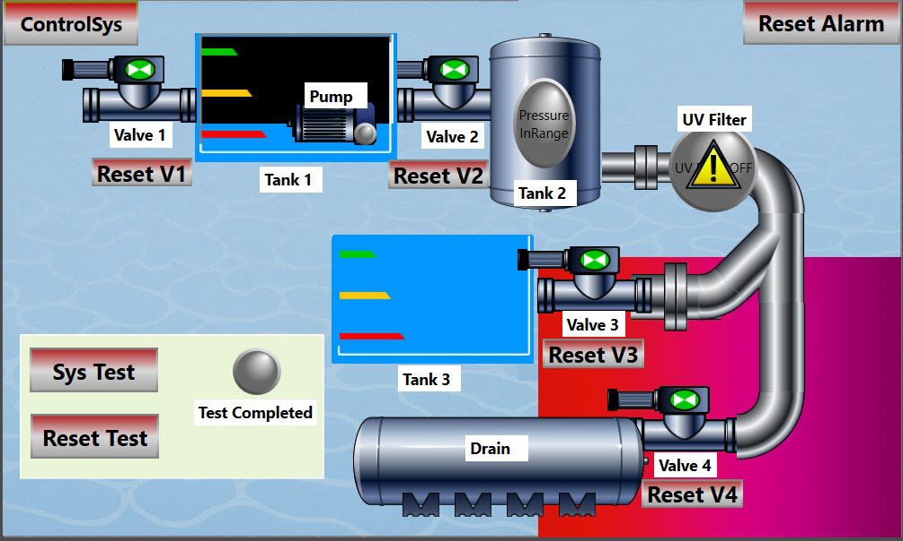
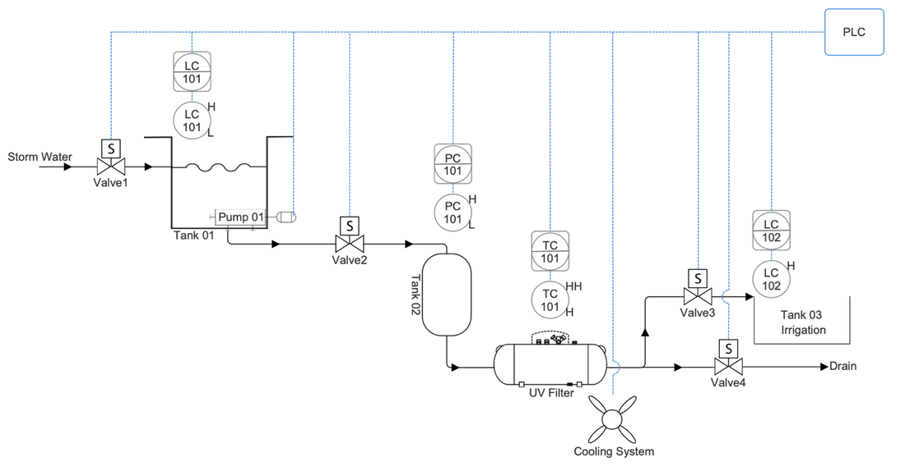
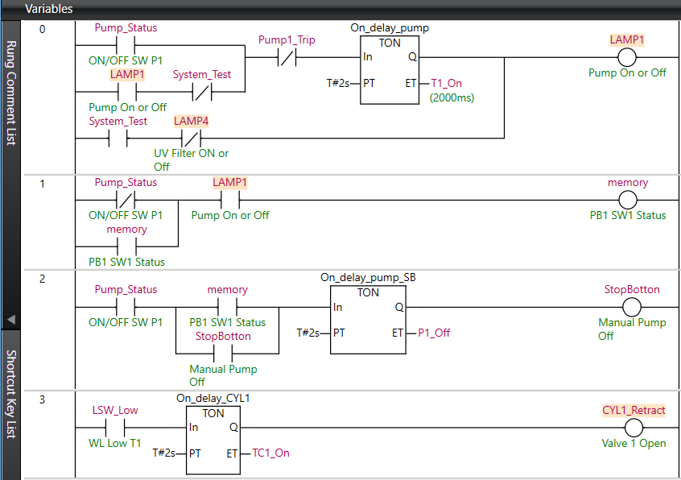
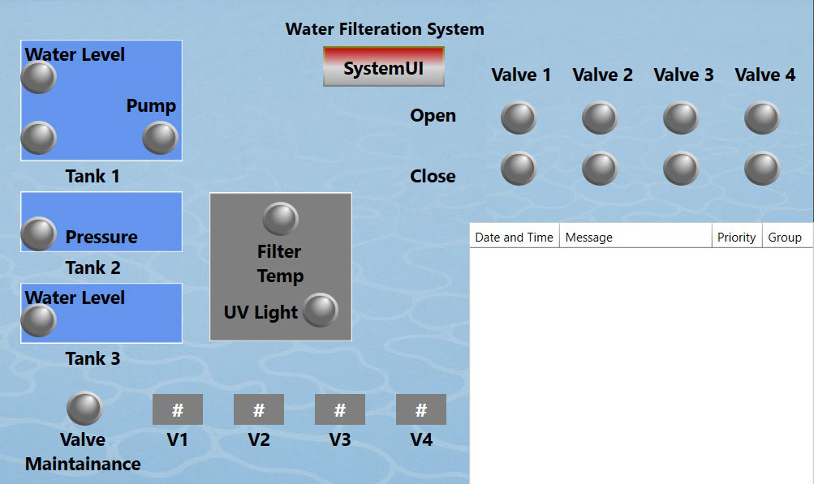
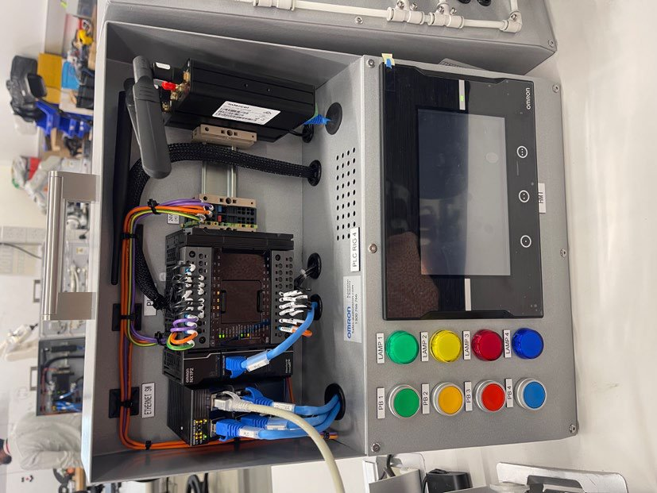
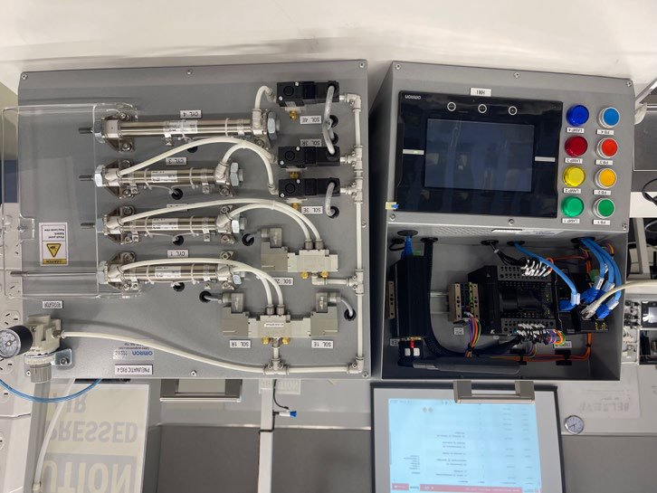

# PLC-Based Smart Stormwater Harvesting System

A PLC control system for a simplified stormwater harvesting and filtering plant: it fills a storage tank, pumps water through a filter stage and a UV disinfection unit, and sends treated water to irrigation or diverts it to drain. The program includes safety interlocks, a preventive-maintenance counter, a self-test routine and a two-screen HMI.

Built on an Omron Sysmac training rig, where pneumatic cylinders stand in for the plant's valves and four pushbuttons stand in for its sensors.

**Demonstration video:** [Watch on Google Drive](https://drive.google.com/file/d/1L9ESjDdyWR5ueM1aXDrVjSyIeBBjk_IC/view?usp=sharing)

  

## The process

  

| Stage | What the PLC does |
|---|---|
| **Tank 1 – inlet and storage** | Opens Valve 1 when the low-level switch trips and stops the pump; closes Valve 1 at the high-level switch. |
| **Tank 2 – pre-filtration** | Closes Valve 2 and stops the pump when the pressure across the filter is too high, which signals a blocked filter. Reopens when pressure returns to range. |
| **UV filtration** | Switches the UV lamp off at the high temperature limit. If the temperature rises again shortly after, it locks the lamp off and runs the cooling system until the temperature is stable. |
| **Tank 3 – distribution** | Sends water to irrigation through Valve 3 only while the UV lamp is working and Tank 3 is not full. Otherwise it closes Valve 3 and opens Valve 4 to drain. The two valves are interlocked so they are never open together. |

## Key design features

### Sixteen inputs from four pushbuttons

The rig has only four pushbuttons, but the process needs signals for level, pressure, temperature and UV status. Each button is treated as one bit, so button combinations give up to 16 virtual inputs:

| Code (B3 B2 B1 B0) | Buttons | Simulated input |
|---|---|---|
| 0001 | Green | Pump start/stop |
| 0010 | Yellow | Tank 1 level low |
| 0100 | Red | Tank 1 level high |
| 1000 | Blue | Tank 2 pressure high |
| 0011 | Green + Yellow | Tank 2 pressure back in range |
| 0101 | Red + Green | UV temperature high |
| 1001 | Blue + Green | Tank 3 level high |
| 1111 | All four | System test |

Pressing several buttons at exactly the same moment is physically difficult, so each combination passes through an on-delay timer (TON) before it counts as an input. That stopped half-pressed combinations from triggering the wrong command.

### Safety and reliability logic

- **Toggle with confirmation.** One momentary button starts and stops the pump, using a memory bit and a 2-second delay so a brief accidental press does nothing.
- **Debounced sensors.** On-delay and off-delay timers on level and pressure signals prevent valves from chattering when a reading hovers around its limit.
- **Two-stage UV protection.** Lamp cut-out first, then lock-out with forced cooling, which avoids rapid on/off cycling and extends lamp life.
- **Preventive maintenance.** A counter tracks open–close cycles for each of the four valves and lights a maintenance lamp after five cycles. Each counter can be reset from the HMI.
- **Self-test.** Pressing all four buttons starts the pump, then checks that the UV lamp turns on, and reports "Test Completed" on the HMI.

  

### HMI

Two screens on the Omron NA5 panel:

- **System Overview** — tank levels, pressure and temperature status, valve positions, maintenance indicators and an alarm history window.
- **Process Control** — an animated process layout with per-valve maintenance resets, the system test button, and alarm and test resets.

  

## Hardware

| Component | Role |
|---|---|
| Omron NX1P2-9024DT1 PLC | Runs all control logic and I/O |
| Omron NA5-7W001B-V1 HMI | Operator display and manual control |
| 4 × pneumatic cylinders with reed switches | Stand in for Valves 1–4, with position feedback |
| 4 × solenoid valves, air regulator with filter | Drive the cylinders |
| 4 × pushbuttons, 4 × indicator lamps | Simulated sensor inputs; pump, maintenance, UV fault and UV status |
| 6 × G2RV-ST700 relays, S8VK 24 V DC supply, Ethernet switch, 4G router | Signal isolation, power and communication |

  
  

The full I/O map (12 inputs, 10 outputs) is in Table 3 of the project report.

## Challenges

- A pushbutton is a momentary input, so using one button to both start and stop the pump needed toggle logic.
- With only four physical inputs, the binary scheme was needed to get more, and multi-button presses then triggered other commands by accident until timers were added.
- The four solenoid valves reacted at slightly different speeds, so timing had to be tuned per valve.
- Cylinders 1 and 4 have two air inputs, one to open and one to close. The cylinders with a single pneumatic input took longer to work out.
- Designing an interactive HMI that shows tank levels and indicators was hard with little prior experience and few online resources.

## Lessons learned

- Every component needs its own safety logic.
- Preventive-maintenance logic saves unnecessary plant breakdowns.
- A PLC program must fail safely in every condition, because a failure can damage expensive equipment or injure someone.

## Repository contents

- `Project Ladder Programming File - Sysmac.smc2` — Sysmac Studio project (ladder program and HMI)
- `Project Report.pdf` — full report with P&ID, rung-by-rung logic and I/O tables
- `ladder hmi.pdf` — ladder logic and HMI screenshots
- `images/` — figures used in this README

To open the project, import the `.smc2` file in Omron Sysmac Studio.

## Technologies

Omron NX1P2 PLC • Sysmac Studio • Ladder logic • Omron NA5 HMI • Pneumatics • P&ID design
